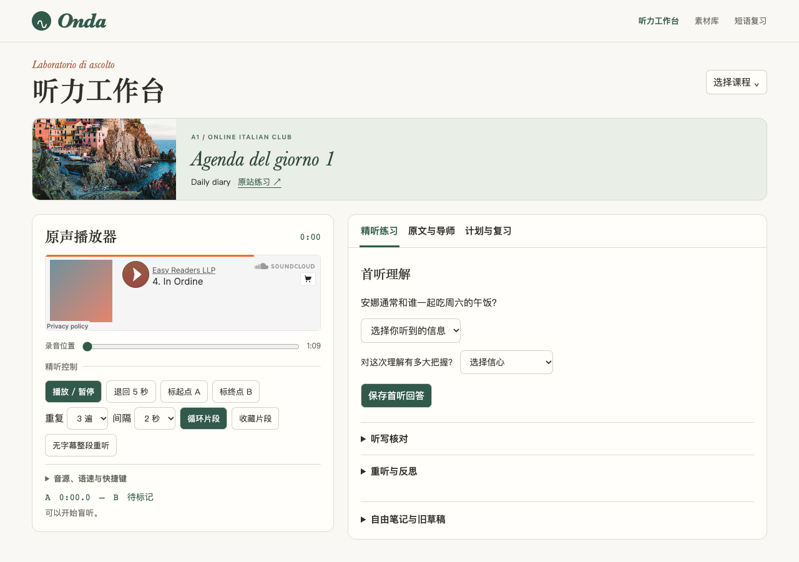

# Onda · 意大利语听力工作台

听一遍意大利语原声，把没听清的半句话标出来，反复听、写下来，隔天再试一次。Onda 是面向中文学习者的本地 Web 应用，整合了 Online Italian Club 的 **47 篇 A1 练习、56 段 A1 原声**，另收录两篇 A2 精听材料。



## 快速开始

安装 Python 3（开发与验证使用 3.11），下载并解压发行包，或克隆本仓库。运行时只使用 Python 标准库，无需安装前端依赖。

```sh
git clone https://github.com/Xinyuan1629/free-italian.git
cd free-italian
python3 server.py
```

打开 [听力工作台](http://127.0.0.1:8736/workspace.html)，或从[课程首页](http://127.0.0.1:8736/)开始。解压 ZIP 的用户直接在含有 server.py 的目录执行最后一条命令。按 Ctrl+C 关闭服务。

## 怎么练一篇

1. **盲听。** 先听原声，再提交大意或理解题并选择信心。当前三篇录音有人工理解题，其余课程记录大意。
2. **精听。** 左右键前后跳 5 秒，A、B 标记片段，空格控制播放。选好重复遍数和间隔，可留时间听写或跟读。原站音源支持分段循环；同版的本地音频支持变速。
3. **核对。** 选择与刚才片段对应的原句，查看遗漏、替换和多写的词。可在“原文与导师”就某一句提问，或收起文本从头重听。字幕对照采用手动选句。
4. **复习。** 收藏困难片段，在“计划与复习”设置每日时间。到期先听、提交识别结果，再核对参考文本。文字短语复习另有独立入口。

## 可选的 ChatGPT 导师

电脑上需要可用的 Codex CLI，并使用自己的账号完成登录。可以先用 `codex login status` 确认状态。导师由本机服务调用 CLI；基础精听和复习可独立使用。使用导师时，当前课程文本、选句和主动提交的问题会发给 OpenAI。账号可用额度及网络连接会影响响应。

## 隐私与联网

- 服务只监听本机回环地址。学习记录、听写和设置保存在当前浏览器对此站点的 localStorage；清除该站点数据会移除记录。更换浏览器或站点地址会使用另一份记录。
- 播放原声需要连接 SoundCloud；进入课程会加载其脚本和嵌入播放器，并可能从原站加载题图。浏览器会向这些服务传递常规网络请求信息。
- 选择本地音频时，浏览器通过临时对象 URL 播放。项目包仅含程序、课程材料与说明。截图使用独立的空白浏览器会话。

## 开发与成果

基础版已实现分段播放、听写对照、随文问答、音频间隔复习和按预算安排的每日计划。正式诊断、独立测评集、多说话者辨音实验室和迁移能力报告仍在产品规划中。

| 文档 | 用途 |
|---|---|
| [提示词与模块分工](docs/PROMPTS.md) | 从学习需求到模块开发的四组可复用提示词 |
| [产品需求](docs/PRD.md) | 训练方法、学习流程与阶段验收 |
| [技术架构](docs/ARCHITECTURE.md) | 当前运行路径、播放器与后续数据模型 |
| [开发约定](AGENTS.md) | 数据隔离、素材边界、回归验证 |

## 许可与致谢

Onda 原创代码和文档使用 [MIT License](LICENSE)。课程原文、题目、录音和照片保留各自来源及使用条件。感谢 Online Italian Club 提供听力材料。[素材来源与许可](THIRD_PARTY.md) · [原站 A1 课程](https://onlineitalianclub.com/free-italian-exercises-and-resources/online-italian-course-beginner-level-a1/)
